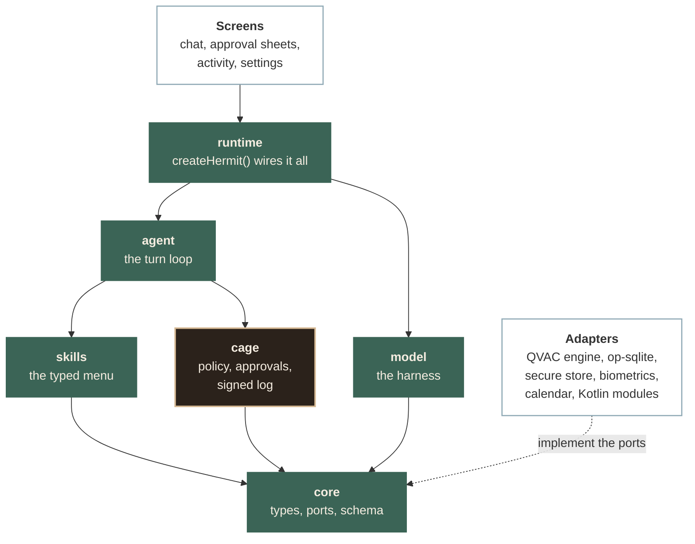
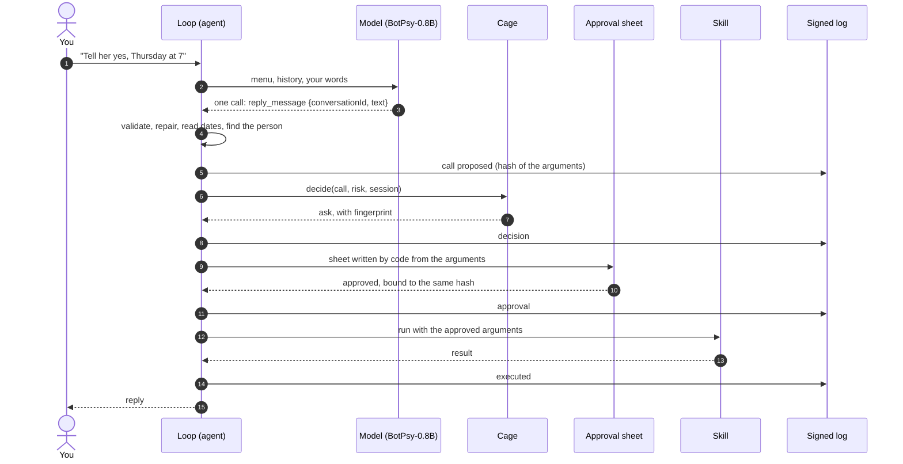

# Architecture

Hermit is a TypeScript monorepo. The agent, the cage, the skills and the model's harness are plain TypeScript packages with no React Native in them. An Expo app supplies the phone's pieces: the screens, the model engine, the encrypted database, the fingerprint and the native modules. The same packages run on Node, which is how they're tested and how the eval lab measures them.

This page maps the code, follows one turn from your words to a signed log entry, and explains the cage, storage and the model runtime. The principles behind it are in [VISION.md](../VISION.md). The full requirements and the decision records are in the [product requirements](prd/hermit-prd.md), with the architecture decisions in [section 2.16](prd/hermit-prd.md#216-architecture-decision-records).

## Three rules the code enforces

1. **Every skill call goes through the cage.** Nothing with a side effect runs without the policy engine's decision, and every step lands in the signed log.
2. **Packages never touch the network.** `fetch`, `XMLHttpRequest` and `WebSocket` are lint errors in `packages/`. Network code lives only in the app's adapters, behind ports.
3. **No analytics, crash reporting or login brokers.** `pnpm check:privacy` fails the build when one appears, including under another package name or as an indirect dependency.

## The shape

Screens and adapters live in `apps/mobile`. The filled boxes are packages under `packages/`. The packages define **ports** (interfaces in [`packages/core/src/ports.ts`](../packages/core/src/ports.ts)): the model, SQL, the signer, approvals, notifications, replies, the calendar, credentials, web fetches and the browser. The phone implements them with real adapters. Tests and the eval implement them with fakes, Node's SQLite and `llama-server`.

## The packages

| Package | Its job |
| :-- | :-- |
| [`core`](../packages/core) | Shared types and ports. Canonical JSON and argument hashing. The database schema as numbered, forward-only migrations. Memory, sessions, reminders, contacts by name, money as integer base units, the vault's encryption, the wallet's history, and the code that reads dates and times from what you said. |
| [`skills`](../packages/skills) | The typed menu. Each skill has an id, a risk class, a JSON schema for its arguments, a normalizer that fixes what code can read better than the model, and `describeAction()`, the code that writes its approval sheet. |
| [`agent`](../packages/agent) | The turn loop, `runTurn()`: pick, fill, repair, normalize, cage, approve, run, log. The skill runtimes for memory, reminders, the calendar, messages, the web and other apps. Looking up people by name. Wrapping other people's text as untrusted. |
| [`cage`](../packages/cage) | The policy engine (`decide()`), taint, approval proofs, signed approvals for money and passwords with one-time nonces, the signed hash-chained audit log and its verification, and the views the Activity screen draws. |
| [`model`](../packages/model) | The harness around the model. Prompts, the router, the native tool-call and two-stage formats, the quarantined reader, model profiles, the download and update rules, the device floor and the device-adaptive runtime plan. |
| [`runtime`](../packages/runtime) | The composition root. `createHermit()` wires the database, the cage's rules, the loop, the skills, the model, the signed log, the vault, the wallet, mail, the night shift and web tasks behind the ports, plus the view models the screens render. |
| [`mail`](../packages/mail) | Email: IMAP and SMTP, Gmail and Microsoft Graph clients, MIME parsing, drafts and the mail skills. |
| [`night`](../packages/night) | The night shift: fixed jobs (agenda, reminders, messages, mail) in unattended sessions while the phone charges, and the morning briefing they leave. Jobs only read. Anything else becomes a suggestion you approve in the morning. |
| [`payments`](../packages/payments) | Money paths: transfer authorizations (EIP-712 and EIP-3009), x402 parsing and payment, the spending ledger and caps, and the message protocol of the wallet worklet. |
| [`connectors`](../packages/connectors) | Experimental. OAuth sign-in with PKCE, the protocol for an optional sign-in relay, an MCP client, and connectors drafted from a service's docs for you to review. |
| [`copy`](../packages/copy) | Every string a person sees, keyed by screen, in `es-419` and `en`. |
| [`eval`](../packages/eval) | The eval sets and runners: the Mac lab against `llama-server`, multi-turn trajectories through the real runtime, and scoring. See [evals.md](evals.md). |
| [`sql-node`](../packages/sql-node) | The SQL port over Node's built-in SQLite, for tests and the eval. |

| App | Its job |
| :-- | :-- |
| [`apps/mobile`](../apps/mobile) | The Expo app (SDK 58, React Native 0.88, Android first). Screens, adapters, Kotlin modules in `modules/`, and the wallet worklet in `worklets/wallet`. |
| [`apps/relay`](../apps/relay) | An optional sign-in relay you can host yourself, for services that demand a client secret. It swaps a sign-in code for tokens, returns them encrypted to the phone and stores nothing. Hermit works without it. |
| [`apps/site`](../apps/site) | The website, [joinhermit.com](https://joinhermit.com). |

## One turn, end to end

1. **Your words come in.** Only what you type in this turn counts as the user's words. Messages, emails, pages and results from tools never do, and the cage uses that difference.
2. **The prompt is built.** A fixed system prompt holds the persona, the skill menu with worked examples in both languages, the local date and time, and up to 1,400 characters of facts you saved yourself. Nothing other people wrote goes into the system prompt. The fixed part is cached, so each turn reads only what's new.
3. **The router narrows the menu.** Phrase rules recognize requests that are clear in either language and either narrow the menu for the turn or require a tool call. A learned router, nearest neighbors over character n-grams of labeled examples, speaks only when it's confident. Questions like "what can you do?" are answered by code from the skills that work on this phone right now.
4. **The model picks and fills.** The shipped profile offers the menu as tools in the model's native chat template, with a short thinking budget and a grammar that constrains the output. The model returns one call, or a reply, or a question for you.
5. **Code checks the call.** The name is matched to the menu, the arguments are parsed, coerced and validated against the skill's schema, and three bad tries end the turn. Dates and times your words pin down are read by code and replace the model's guess. A person you named becomes a number or an address by code, from your contacts, before the cage sees the call. A WhatsApp reply can only name a conversation Hermit already read, and code resolves who that is, so the model can never type in a recipient.
6. **The arguments are canonicalized and hashed.** `argsHash` is the SHA-256 of canonical JSON with sorted keys. Everything after this point is bound to that hash.
7. **The cage decides:** allow, ask or deny. See [the cage](#the-cage).
8. **You approve, when asked.** The sheet comes from the skill's `describeAction()`, never from the model. It shows the exact action, who it reaches, the words you said, and why Hermit suggested it if the session read other people's text.
9. **The skill runs** through a port. Its result goes back to the model. Text other people wrote comes back wrapped in markers with a random seal, so it can't close its own wrapper, and the session becomes tainted.
10. **Every step is logged.** Proposed, decided, approved, executed: each is an entry in the signed chain.

Limits and guards on every turn:

- At most four skill calls per turn.
- An identical call already done this turn isn't run again.
- A reply that claims success after an action failed is replaced with a plain "I couldn't do that".
- A long answer is allowed only when your words ask for one (a recipe, steps, a list, more detail). A reply cut at its cap says so and offers to continue.
- Stopping a turn closes any open sheet as declined. A skill that already started finishes, so nothing is left half done.
- When other people's text needs summarizing, a separate **quarantined reader** call does it, with no skills, no memory and no history. It returns a short paragraph and exact quotes, and any quote it invented is dropped.

## The cage

The cage lives in [`packages/cage`](../packages/cage). It's small on purpose, and it's where most of the tests are.

### Risk classes and defaults

Every skill declares a risk. The defaults, by session state:

| Risk | Examples | You're there | You're there, after Hermit read others' text | At night, with nobody there |
| :-- | :-- | :-- | :-- | :-- |
| `read` | recall, read your calendar, read messages | allow | allow | allow |
| `local_write` | remember, remind, add an event | allow | ask | doesn't run; can wait for the morning as a suggestion |
| `network` | read a page, search, list mail | ask once per site in a session | ask, unless you typed that exact address or query this turn | only the reads a night job you turned on needs |
| `remote_write` | save a draft, archive mail | ask | ask, with the warning | doesn't run; can wait for the morning |
| `send` | reply on WhatsApp, send an email | ask, with fingerprint | ask, with fingerprint and the warning | doesn't run; can wait for the morning |
| `credential` | fill a login | ask, with fingerprint and a hardware signature | deny | doesn't run |
| `spend` | pay a person, pay a site with x402 | ask, with fingerprint and a hardware signature, within caps | deny | doesn't run |

### How a decision is made

- **Deny wins.** Floor rules are checked first, then any matching deny, then ask, then allow. No matching rule means deny.
- **Hard limits** apply after the rules, and no rule set can loosen them:
  - money and passwords are denied in a tainted or unattended session, and otherwise always ask for a hardware-signed approval;
  - a send or a change outside the phone always asks;
  - a tainted session's local writes ask;
  - a tainted session's fetches ask, unless you typed that exact address or search this turn, and then only your matched words go out;
  - a recipient code found by name always asks, so you can check it's the right person;
  - with nobody there to approve, every ask becomes a deny.
- **Taint is sticky.** Once a session reads other people's text, it stays tainted until you clear it, and memories saved in it are marked as coming from others. Those never enter the system prompt.

### Approvals

- **Bound to the exact action.** An approval names one request and one `argsHash`. If the arguments change, it doesn't count.
- **Sends** need your fingerprint. The proof is an HMAC over the hash and the request id, with an approval key that the phone only releases after the biometric prompt.
- **Money and passwords** need a signature from a non-exportable Android Keystore key (ECDSA P-256) that demands a strong biometric for every single use. It signs a canonical payload that names the amount, the recipient or the site, a one-time nonce and an expiry of at most two minutes. The fingerprint prompt shows the amount and the address again, the signature is checked against the key pinned when you enrolled it, and the nonce can't be replayed, even after a restart.
- **Payments check caps first.** Before the sheet opens, code checks the payment against your words, the per-payment and per-day caps and the balance, and reserves it. A refusal ends the turn in code's words.
- **Silence is a no.** A sheet that expires, crashes or gets dismissed counts as declined, and so does stopping the turn.

### The signed log

- An append-only SQLite table. Each entry holds metadata and hashes only: the time, the session, the event, the skill, the arguments' hash, the decision and the outcome. Never a message body or an argument.
- Each entry's hash covers the previous entry's hash plus a fixed tuple of its fields. Each hash is signed with an Ed25519 key kept on the phone.
- `verifyChain()` checks every link and every signature. The Activity screen shows "Chain verified", or where the chain broke.
- Clearing the log starts a new chain whose first entry records the clear, the old head hash and how many entries it removed.
- It's **tamper-evident, not immutable.** A phone can rewrite its own log, but not without breaking the chain.

## Storage

Everything lives on the phone. App data is excluded from Android's cloud backup.

| What | Where | Protection |
| :-- | :-- | :-- |
| Chats, memories, reminders, messages Hermit read, the signed log, settings, briefings, payees, caps and the spending ledger | One SQLite database ([op-sqlite](https://github.com/OP-Engineering/op-sqlite) with SQLCipher and FTS5) | Encrypted with a random 32-byte key kept in the Android Keystore-backed secure store. |
| Vault logins | Rows in the same database | Names and sites stay listable. Usernames, passwords and notes are sealed with AES-256-GCM under a separate vault key, which is stored only wrapped by a Keystore key that needs a strong biometric for every use. Each sealed blob is bound to its item. |
| The wallet's seed | Made inside the wallet worklet (WDK running in Bare), then kept sealed in the secure store, apart from the database | Sealed with AES-256-GCM under a wallet key that needs a strong biometric for every use. It never reaches JavaScript, except on the backup screen behind a fresh fingerprint, and payments are signed inside the worklet. |
| The audit log's signing seed and the approval key | Android Keystore-backed secure store | The approval key needs a biometric for each use. |
| The model file | App storage, outside backups | Checked against its pinned SHA-256 before it's used. Updates are accepted only from a manifest signed with a key pinned in the app, and they're off in current builds. |
| Host counts | The database | One row per host Hermit contacted: the host and a count. Never what was asked. Settings, Privacy shows them. |

Local events, like how long a turn took, stay in the database and carry no content. **Delete everything** runs an ordered, resumable plan that removes the database, every key Hermit created and the files its native modules wrote.

## Model runtime

### The engine

- **QVAC** ([`@qvac/sdk`](https://github.com/tetherto/qvac), pinned exactly) runs llama.cpp inside a Bare worklet through `react-native-bare-kit`. Tool calls come back unexecuted. Hermit never hands QVAC a tool handler, so nothing can run outside the cage.
- **The model** is [BotPsy-0.8B](https://huggingface.co/qvac/BotPsy-0.8B), a tool-calling model built on Qwen3.5-0.8B, as a 4-bit GGUF (`Q4_K_M`, 529,296,960 bytes). The app downloads it once from Hugging Face over HTTPS, at a pinned revision, and refuses it unless the SHA-256 matches. It never uses peer-to-peer model sources.
- **A profile is the unit we evaluate.** It pins the model file and every setting that changes its behavior: the tool format, the thinking budget, the sampling, the reply caps and the context size. The shipped profile is `botpsy-q4-native-think256`: native tool calls, a 256-token thinking budget, temperature 0.3, top-p 0.95, top-k 20, presence penalty 1.5, and an 8,192-token context.
- **CPU, not GPU.** For a model this small on the phones we measured, the CPU decodes faster than the GPU backends, and one GPU backend broke grammar-constrained decoding.

### Which phones

Before downloading anything, Hermit checks the floor: Android 13 or later, arm64, about 8 GB of RAM, and a CPU with the ARMv8.2 dot-product instructions. A fact the phone can't read never blocks. When the only problem is speed, you can still download with a warning. Phones then fall into tiers, from RAM, fast cores and CPU features, and each tier starts with its own defaults for context, batch size and thinking.

### Device-adaptive threads

llama.cpp waits for its slowest thread, and Android moves an app between sets of CPU cores as it comes and goes. On the Galaxy S26 Ultra, an app on screen gets cores 0 to 5, and an app in the background gets 0, 1, 4 and 5. Ask for more threads than the cores you're allowed and they spin and wait for each other. Measured on that phone:

| Threads | Tokens per second |
| :-: | :-: |
| 8 | 0.2 |
| 6 | 31 to 43 |
| **5** | **37 to 42** |
| 4 | 31 |
| 2 | 21 |

So Hermit plans its threads from the cores Android allows right now:

- **threads = max(1, min(fast allowed cores, allowed cores minus 1, 5)),** with a core mask over the fast allowed cores. "Fast" means within 75% of the top cluster's clock, so little cores don't hold everyone back.
- **It reloads at safe points only.** llama.cpp reads its threads at load time, so when the allowed cores change, the engine reloads before a turn starts and never in the middle of one. That takes about 2 seconds on the S26.
- **It calibrates once.** On first run it measures up to four candidate plans and keeps the fastest one that still passes a tool-call and schema check. A result measured while the phone was warm counts as slower, so heat doesn't lock in a small plan.
- **It budgets per request.** Heat, battery saver and memory pressure shrink the thinking budget first and the reply cap second, without a reload. When heat stays high, the next safe point drops two threads.

### The Mac lab

The eval lab runs the same GGUF on llama.cpp's `llama-server`, with the same harness code. Accuracy carries over from the phone. Speed doesn't, so speed is always measured on phones. Details in [evals.md](evals.md).

## Where to go next

- [evals.md](evals.md): how Hermit measures itself, and how to run the sets.
- [`packages/agent/src/loop.ts`](../packages/agent/src/loop.ts): the turn loop, in one file.
- [`packages/cage/src/policy.ts`](../packages/cage/src/policy.ts): the cage's rules and hard limits.
- [`packages/model/src/runtime.ts`](../packages/model/src/runtime.ts): the device-adaptive runtime.
- [AGENTS.md](../AGENTS.md): working rules for coding agents.
